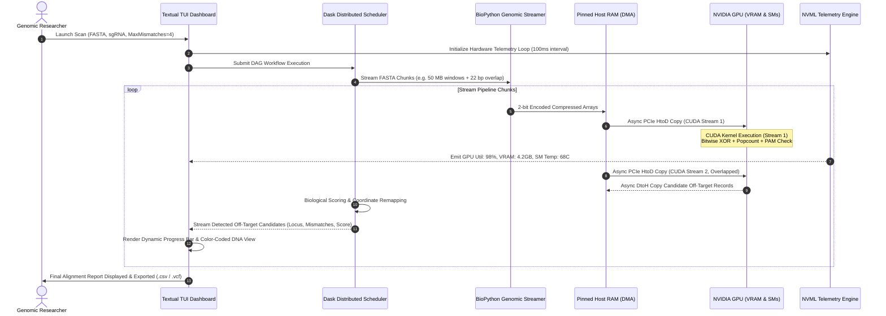

# GeneWeaver: System Architecture Blueprint & Blueprint Specification

## 1. Executive Summary & Vision

**GeneWeaver** is an enterprise-grade, GPU-accelerated computational genomics engine purpose-built to eliminate the primary bottleneck in therapeutic gene editing: **CRISPR-Cas9 off-target mutation detection across whole-genome scales**. 

The human genome spans roughly **3.2 billion base pairs ($3.2 \times 10^9\text{ bp}$)**. When clinical researchers design single guide RNAs (sgRNAs) targeting a specific disease locus (such as sickle cell anemia or Huntington's disease), the Cas9 endonuclease can tolerate minor mismatches (1–5 base pair discrepancies) and inadvertently cleave non-target genomic sites, leading to oncogenic translocations, gene disruptions, or cell death.

Standard algorithmic implementations in pure Python (such as iterative sliding windows or standard regular expressions) require **days** of CPU wall-clock time per genome. Legacy academic solutions (e.g., Cas-OFFinder in raw C++ OpenCL/CUDA or Bowtie2/BWA-based aligners) suffer from steep learning curves, brittle cluster configuration dependencies, and fragmented telemetry.

GeneWeaver bridges this divide by delivering a high-performance hybrid architecture:
- **High-Level Orchestration & Ergonomics:** High-level Python developer velocity, BioPython stream parsing, and Dask distributed scheduling.
- **Hardware-Level Acceleration:** Low-level, JIT-compiled NVIDIA CUDA kernels using Numba, directly compiling to PTX/SASS and bypassing Python’s Global Interpreter Lock (GIL).
- **Extreme Memory Density:** 2-bit binary DNA encoding compressing nucleotide sequences by 75% (from 1 byte per base to 2 bits per base), maximizing GPU L1/L2 cache and shared memory efficiency.
- **Real-Time Human-in-the-Loop Telemetry:** A reactive Terminal User Interface (TUI) powered by Textual and NVML, rendering live streaming alignments, mutated base mismatch visualizers, and GPU hardware metrics.

---

## 2. High-Level Architecture Blueprint

```
+---------------------------------------------------------------------------------------------------+
|                                       GENEWEAVER SYSTEM STACK                                     |
+---------------------------------------------------------------------------------------------------+

       +------------------------------------+          +------------------------------------+
       |       Input: Human Genome          |          |        Input: CRISPR sgRNA         |
       |     Raw FASTA Format (.fa/.fasta)  |          |   20nt Guide + 3nt PAM (e.g. NGG)  |
       |         (~3.2 Billion Bases)       |          |     + Max Mismatch Tolerance (1-6) |
       +-----------------+------------------+          +-----------------+------------------+
                         |                                               |
                         +-----------------------+-----------------------+
                                                 |
                                                 v
+---------------------------------------------------------------------------------------------------+
| 1. GENOMIC STREAMING & ENCODING INGESTION ENGINE (BioPython + Custom 2-Bit Vectorizer)           |
|                                                                                                   |
|  * Stream-based memory-mapped parsing (Biopython SeqIO streaming / custom buffer chunks)          |
|  * IUPAC Cleanse: Filter ambiguous bases ('N', 'R', 'Y') with coordinate bitmasks                 |
|  * 2-Bit Nucleotide Compression: 'A' -> 00, 'C' -> 01, 'G' -> 10, 'T' -> 11                       |
|  * Overlapped Chunking: Chunks of size S with (L_guide + L_pam - 1) boundary overlap              |
+------------------------------------------------+--------------------------------------------------+
                                                 |
                                                 v
+---------------------------------------------------------------------------------------------------+
| 2. DISTRIBUTED ORCHESTRATION LAYER (Dask / Dask-CUDA Distributed DAG)                             |
|                                                                                                   |
|  * LocalCUDACluster / Multi-Node Scheduler                                                        |
|  * NUMA-aware GPU worker assignment (Worker 0 -> GPU 0, Worker 1 -> GPU 1)                       |
|  * Pinned Host Memory allocation (cuda.pinned_array) to achieve 25+ GB/s PCIe 4.0/5.0 DMA HtoD    |
|  * Asynchronous pipeline execution via Dask delayed futures & CUDA streams                        |
+------------------------------------------------+--------------------------------------------------+
                                                 |
                                                 v
+---------------------------------------------------------------------------------------------------+
| 3. MASSIVELY PARALLEL CUDA KERNEL ENGINE (Numba @cuda.jit)                                        |
|                                                                                                   |
|   +--------------------------------------------------------------------------------------------+  |
|   | GPU Streaming Multiprocessors (SMs)                                                        |  |
|   |                                                                                            |  |
|   |   +-------------------------------+      +----------------------------------------------+  |  |
|   |   | CUDA Shared Memory Tile (L1)  |      | Constant Memory Cache (64 KB)                |  |  |
|   |   | High-speed staging of target  |      | Broadcast sgRNA 2-bit bitmask + PAM filter   |  |  |
|   |   | genomic slices across threads |      | across all warps with zero latency           |  |  |
|   |   +---------------+---------------+      +----------------------+-----------------------+  |  |
|   |                   |                                             |                          |  |
|   |                   v                                             v                          |  |
|   |   +-------------------------------------------------------------------------------------+  |  |
|   |   | Warp-Synchronous Bit-Parallel Alignment & Scoring Core                              |  |  |
|   |   |  - XOR bitwise comparison: (Genome_Window ^ sgRNA_Pattern)                           |  |  |
|   |   |  - Hardware POPC (Population Count) for sub-nanosecond Hamming Distance             |  |  |
|   |   |  - Canonical PAM Verification: (Base[21:23] & 0x1111) == 'GG'                       |  |  |
|   |   |  - On-chip Hsu-Zhang / CFD cleavage likelihood score computation                     |  |  |
|   |   +-------------------------------------------------------------------------------------+  |  |
|   |                   |                                                                        |  |
|   |                   v                                                                        |  |
|   |   +-------------------------------------------------------------------------------------+  |  |
|   |   | Atomic Aggregation & Candidate Ring Buffer                                          |  |  |
|   |   | Device global memory candidate hits written atomically; filtered by score threshold |  |  |
|   |   +-------------------------------------------------------------------------------------+  |  |
|   +--------------------------------------------------------------------------------------------+  |
+------------------------------------------------+--------------------------------------------------+
                                                 |
                                                 v (Asynchronous DtoH DMA Transfer)
+---------------------------------------------------------------------------------------------------+
| 4. REDUCTION, RANKING & BIOLOGICAL SCORING STAGE                                                  |
|                                                                                                   |
|  * Global hit reduction and coordinate re-projection to chromosome locus                          |
|  * Cutting Frequency Determination (CFD) and Hsu-Zhang off-target cleavage probability rank      |
|  * Genomic annotation cross-referencing (Coding Exon vs Intron vs Intergenic locus)               |
+------------------------------------------------+--------------------------------------------------+
                                                 |
                                                 v
+---------------------------------------------------------------------------------------------------+
| 5. REAL-TIME TELEMETRY & TUI PRESENTATION ENGINE (Textual + Rich + NVML)                          |
|                                                                                                   |
|  * Async telemetry worker polling NVIDIA Management Library (NVML) @ 10 Hz                        |
|  * Live VRAM usage gauges (Allocated / Pinned / Free) and Streaming SM Core Utilization           |
|  * Real-time progress bars: FASTA chunking, HtoD Transfer, GPU Compute, Reduction                |
|  * Interactive Terminal Mismatch Visualizer:                                                      |
|       Target: ATGCGATCGATCGAACGTAC NGG                                                            |
|       Locus:  ATGCTATCGATCCAACGTAC AGG  [Score: 0.842 | Mismatches: 2 (Pos 5, 13)]              |
|                    ^       ^                                                                      |
+---------------------------------------------------------------------------------------------------+
```

---

## 3. End-to-End Data Pipeline Flow

The execution workflow of GeneWeaver follows a strict, non-blocking asynchronous pipeline designed to saturate PCIe bandwidth and keep GPU compute units at 100% occupancy.



---

## 4. Hardware and Software Concurrency Model

### 4.1. Memory Hierarchy Mapping
To achieve the targeted sub-3-minute full-genome scan, data transfers must minimize latency across the hardware hierarchy:

| Memory Tier | Bandwidth | Typical Size | GeneWeaver Utilization |
| :--- | :--- | :--- | :--- |
| **Registers** | $\sim 30\text{ TB/s}$ | $\sim 256\text{ KB/SM}$ | sgRNA bitmasks, loop counters, popcount intermediates |
| **Shared Memory (L1 Cache)** | $\sim 10\text{ TB/s}$ | $48-128\text{ KB/SM}$ | Genomic chunk tiles loaded collaboratively by thread blocks |
| **Constant Memory Cache** | $\sim 1-2\text{ TB/s}$ | $64\text{ KB}$ | Guide RNA sequence, PAM matrix, Hsu-Zhang weight tables |
| **Device Global Memory (VRAM)**| $900-1000\text{ GB/s}$ | $16-24\text{ GB}$ (RTX 4090) | Master chunk buffers, candidate hit arrays, atomic counters |
| **Host Pinned RAM (PCIe Gen 4/5)**| $25-64\text{ GB/s}$ | $64-128\text{ GB}$ | Asynchronous DMA buffer queues feeding GPU streams |
| **Pageable Host Memory** | $\sim 15-20\text{ GB/s}$ | $64-256\text{ GB}$ | Raw FASTA string parsing, BioPython sequence dictionary |
| **NVMe Storage** | $3.5-7.0\text{ GB/s}$ | Multi-TB | Human reference genome storage (`hg38.fa`, $3.2\text{ GB}$) |

### 4.2. GPU Thread Organization Strategy
- **Grid Structure:** 1-Dimensional grid matching genomic window chunks.
- **Block Size ($B_x$):** Configured to **256 or 512 threads per block** (multiples of warp size 32), ensuring maximum warp occupancy on modern architectures (Ada Lovelace, Ampere, Turing).
- **Grid Size ($G_x$):** Calculated dynamically:
  $$\text{GridSize} = \left\lceil \frac{\text{ChunkLength} - (\text{GuideLength} + \text{PAMLength}) + 1}{\text{ThreadsPerBlock}} \right\rceil$$
- **Coalesced Memory Access:** Adjacent threads inspect adjacent base positions. By utilizing 32-bit integer loads where each word contains 16 bases, memory reads coalesce into single 128-byte cache line transactions.

---

## 5. Failure Modes and OOM Resilience Strategy

Handling whole-genome data on consumer and workstation GPUs introduces significant risk of `CUDA_OUT_OF_MEMORY` (OOM) errors. GeneWeaver prevents memory failures through:

1. **Chunk Budgeting Engine:**
   $$\text{MaxChunkSize}_{\text{bytes}} = \frac{\text{AvailableVRAM} \times \text{SafetyFactor}(0.65)}{\text{NumCUDAStreams}(2) \times (\text{InputFactor} + \text{OutputBufferFactor})}$$
   The pipeline dynamically queries `cudaMemGetInfo()` before dispatching Dask tasks, adjusting chunk sizes to avoid exceeding 70% VRAM allocation.

2. **Ring Buffer & Bounded Output Arrays:**
   Instead of allocating unbounded memory for hits, kernels write to fixed-size candidate buffers with an atomic counter. If candidate hits exceed the buffer capacity, the kernel sets an overflow flag, and the scheduler halves the mismatch tolerance or partitions the sub-chunk.

3. **Graceful Degeneration to CPU Worker:**
   If a GPU device driver crash or allocation failure occurs, Dask reroutes the affected partition to a vectorized CPU fallback pipeline (using NumPy + CFFI/Cython) without terminating the overall job.

---

## 6. Directory Layout & Repository Structure

```
geneweaver/
├── README.md                          # Project overview, benchmarks, quickstart
├── pyproject.toml                     # Poetry/pip build specification and dependencies
├── environment.yml                    # Conda environment with CUDA toolkit & Numba
├── docs/                              # Technical specifications and manuals
│   ├── 01_SYSTEM_ARCHITECTURE.md      # This blueprint document
│   ├── 02_BIOLOGY_AND_CRISPR_SPECIFICATION.md
│   ├── 03_CUDA_KERNEL_ENGINE.md
│   ├── 04_DISTRIBUTED_PIPELINE_DASK.md
│   ├── 05_TUI_DASHBOARD_TEXTUAL.md
│   ├── 06_IMPLEMENTATION_ROADMAP_WEEKLY.md
│   ├── 07_BENCHMARKING_AND_VALIDATION.md
│   ├── 08_DEVELOPER_SETUP_AND_TROUBLESHOOTING.md
│   └── assets/                        # Diagrams, screenshots, and visual assets
├── src/
│   ├── geneweaver/
│   │   ├── __init__.py
│   │   ├── cli.py                     # Entry point for the CLI / TUI launcher
│   │   ├── parser/                    # FASTA streaming & binary encoding
│   │   │   ├── fasta_streamer.py
│   │   │   ├── bit_encoder.py
│   │   │   └── mock_genome.py         # Synthetic benchmark genome generator
│   │   ├── cuda/                      # Numba GPU kernels & CUDA abstractions
│   │   │   ├── kernels.py             # Global & shared-memory alignment kernels
│   │   │   ├── bit_parallel.py        # Bitwise XOR + POPC accelerated search
│   │   │   ├── memory_manager.py      # Pinned memory & CUDA stream handling
│   │   │   └── scoring_gpu.py         # GPU-resident Hsu-Zhang / CFD scoring
│   │   ├── scheduler/                 # Dask multi-GPU distribution
│   │   │   ├── cluster.py             # LocalCUDACluster lifecycle manager
│   │   │   ├── dask_pipeline.py       # Distributed task graph construction
│   │   │   └── chunker.py             # Overlapped partitioner
│   │   ├── biology/                   # Biological models & score algorithms
│   │   │   ├── pam.py                 # PAM motif parsers (SpCas9, SaCas9, Cas12a)
│   │   │   ├── hsu_zhang.py           # Hsu-Zhang matrix implementation
│   │   │   └── cfd.py                 # Cutting Frequency Determination model
│   │   ├── tui/                       # Textual terminal user interface
│   │   │   ├── app.py                 # Main Textual App class
│   │   │   ├── widgets/               # GPU gauges, progress, alignment viewer
│   │   │   └── telemetry.py           # NVML background monitor
│   │   └── baseline/                  # CPU benchmarks for Week 1 baseline
│   │       ├── cpu_aligner.py         # Pure Python sliding window & regex
│   │       └── biopython_baseline.py
├── tests/                             # Comprehensive test suite
│   ├── unit/
│   ├── integration/
│   └── test_kernels.py
└── benchmarks/                        # Rigorous profiling & benchmarking suite
    ├── run_cpu_baseline.py
    ├── run_gpu_benchmark.py
    └── profile_nv_nsight.py
```
