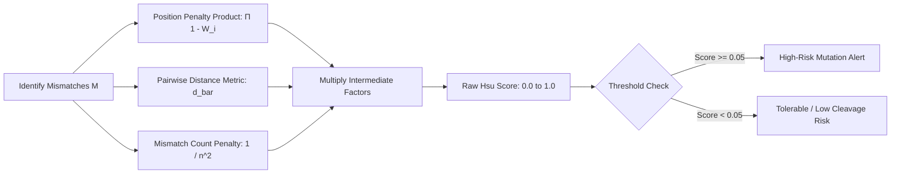

# CRISPR-Cas9 Biological Principles & Algorithmic Formulation

## 1. Biological Mechanism of CRISPR-Cas9

The **CRISPR-Cas9** (Clustered Regularly Interspaced Short Palindromic Repeats / CRISPR associated protein 9) system is an RNA-guided endonuclease system adapted from the bacterial adaptive immune system (*Streptococcus pyogenes*). In synthetic genome engineering, Cas9 is targeted to a specific locus using a synthetic **single guide RNA (sgRNA)**.

```
Target DNA (+) 5' - ... N N N N N N N N N N N N N N N N N N N N  N G G ... - 3'
                        | | | | | | | | | | | | | | | | | | | |  | | |
Guide RNA      3' - ... N N N N N N N N N N N N N N N N N N N N  - - - ... - 5'
                        [ PAM-Distal Region ] [  Seed Region  ]  [PAM]
                          (Bases 1 to 10)       (Bases 11 to 20)  (21-23)
                                                     ^ Cleavage Site (3 bp upstream of PAM)
```

### 1.1. Key Anatomical Components
1. **Target-Specific Guide Sequence (Spacer):** 20 nucleotides (nt) complementary to the target genomic DNA strand.
2. **Protospacer Adjacent Motif (PAM):** A short 3-nucleotide sequence immediately following the 20nt target site on the non-target DNA strand. For canonical *SpCas9*, the PAM sequence is **5'-NGG-3'** (where N is any base: A, C, G, or T).
3. **Seed Region (Nucleotides 11–20, proximal to PAM):** The 8–10 nucleotides immediately upstream of the PAM. Mismatches in this seed region severely reduce or abolish Cas9 binding and cleavage activity.
4. **PAM-Distal Region (Nucleotides 1–10):** The 5' end of the sgRNA. Cas9 demonstrates higher tolerance for mismatches in this region, making it the primary origin of unintended off-target cleavage events.
5. **Cleavage Site:** Cas9 utilizes its dual nuclease domains (RuvC and HNH) to create a blunt double-strand break (DSB) **3 base pairs upstream of the PAM** (between bases 17 and 18).

---

## 2. The Off-Target Problem in Genomic Medicine

When Cas9 is deployed in therapeutic applications (e.g., ex vivo T-cell editing or in vivo gene delivery), off-target cleavage at non-intended genomic sites poses serious clinical hazards:
- **Oncogenic Translocations:** Cleavage at two non-target sites can induce chromosomal rearrangements or fuse proto-oncogenes.
- **Inadvertent Tumor Suppressor Knockout:** Cutting within functional exons of genes like *TP53* can trigger clonal expansion of pre-cancerous cells.
- **Genotoxicity & Cytotoxicity:** Massive unrepairable double-strand breaks trigger p53-mediated apoptosis.

Because the human genome contains over **3.2 billion base pairs ($3.2 \times 10^9\text{ bp}$)**, a 20-nt guide sequence with up to 4–6 tolerated mismatches can occur at **thousands of unintended genomic coordinates**. Exhaustive search through every 23-bp window (both forward and reverse-complement strands) requires evaluating over **6.4 billion potential alignments**.

---

## 3. Mathematical Off-Target Scoring Models

GeneWeaver implements the two industry-standard, experimentally validated off-target scoring models: **Hsu-Zhang Score** (MIT Zhang Lab) and **Cutting Frequency Determination (CFD) Score** (Broad Institute / Doench Lab).

### 3.1. Hsu-Zhang Scoring Matrix (MIT, Nature Biotech 2013)

The Hsu-Zhang scoring function computes the cleavage probability of an off-target site $S_{\text{Hsu}}$ as a compound product of position-dependent mismatch penalties, an inter-mismatch distance factor, and a penalty for total mismatch count:

$$S_{\text{Hsu}} = \left( \prod_{i \in M} (1 - W[i]) \right) \times \left( \frac{1}{\frac{19 - \bar{d}}{19} \times 4 + 1} \right) \times \left( \frac{1}{n^2} \right)$$

Where:
- $M$: The set of mismatch positions along the 20-nt guide sequence (indexed 1 to 20, where 20 is immediately adjacent to the PAM).
- $W[i]$: Empirically measured single-mismatch cleavage penalty at position $i$:

| Position $i$ | 1 | 2 | 3 | 4 | 5 | 6 | 7 | 8 | 9 | 10 |
| :--- | :---: | :---: | :---: | :---: | :---: | :---: | :---: | :---: | :---: | :---: |
| Penalty $W[i]$ | 0.000 | 0.000 | 0.014 | 0.000 | 0.000 | 0.395 | 0.317 | 0.000 | 0.389 | 0.079 |

| Position $i$ | 11 | 12 | 13 | 14 | 15 | 16 | 17 | 18 | 19 | 20 |
| :--- | :---: | :---: | :---: | :---: | :---: | :---: | :---: | :---: | :---: | :---: |
| Penalty $W[i]$ | 0.445 | 0.508 | 0.613 | 0.851 | 0.732 | 0.828 | 0.615 | 0.804 | 0.685 | 0.583 |

- $\bar{d}$: The average pairwise distance between all consecutive mismatch positions:
  $$\bar{d} = \frac{1}{n - 1} \sum_{k=1}^{n-1} (m_{k+1} - m_k) \quad (\text{if } n > 1, \text{ else } 19)$$
- $n$: Total number of mismatches ($n = |M|$). If $n = 0$, $S_{\text{Hsu}} = 1.0$ (100% on-target cleavage).



### 3.2. Cutting Frequency Determination (CFD) Model

The CFD score accounts for both **mismatch position** and **identity of the base substitution** (e.g., an rG:dT mismatch behaves differently than an rC:dA mismatch):

$$\text{CFD\_Score} = \text{Score}_{\text{PAM}} \times \prod_{i \in M} \text{Weight}(i, \text{guide\_base}_i, \text{target\_base}_i)$$

Where:
- $\text{Score}_{\text{PAM}}$: Canonical `NGG` has weight $1.00$. Alternate PAMs: `NAG` ($0.259$), `NGA` ($0.069$).
- $\text{Weight}(i, B_{\text{guide}}, B_{\text{target}})$: A $20 \times 4 \times 4$ tensor obtained from high-throughput cleavage assays (Doench et al., 2016).

---

## 4. High-Performance DNA Encoding: 2-Bit Binary Compression

### 4.1. The Memory Footprint Challenge
In standard FASTA files, each nucleotide is represented as an 8-bit ASCII character (`'A'=0x41`, `'C'=0x43`, `'G'=0x47`, `'T'=0x54`).
- Raw human genome: $3.2 \times 10^9 \text{ bytes} \approx 3.2\text{ GB}$.
- Adding reverse complement doubles this to $6.4\text{ GB}$.
- Transferring $6.4\text{ GB}$ across PCIe 4.0 x16 ($25\text{ GB/s}$) requires $\approx 256\text{ ms}$, but traversing uncompressed ASCII through GPU L1 caches causes severe cache thrashing and memory bus saturation.

### 4.2. 2-Bit Binary Encoding Scheme
Because DNA consists of only 4 canonical bases, each base can be strictly mapped into **2 binary bits**:

| Base | Character | Binary Code | Hexadecimal |
| :---: | :---: | :---: | :---: |
| **Adenine** | `'A'` / `'a'` | `0b00` | `0x0` |
| **Cytosine** | `'C'` / `'c'` | `0b01` | `0x1` |
| **Guanine** | `'G'` / `'g'` | `0b10` | `0x2` |
| **Thymine** | `'T'` / `'t'` / `'U'` | `0b11` | `0x3` |

### 4.3. Bit-Packing Architecture
Four bases fit into a single byte (`uint8`), 16 bases into a 32-bit word (`uint32`), and **32 bases into a single 64-bit word (`uint64`)**.

```
Single uint64 Register (Holds 32 contiguous DNA base pairs):
+----+----+----+----+----+----+----+----+----+----+----+----+----+----+----+----+
| B0 | B1 | B2 | B3 | B4 | B5 | B6 | B7 | .. | .. | .. | .. |B28 |B29 |B30 |B31 |
+----+----+----+----+----+----+----+----+----+----+----+----+----+----+----+----+
  00   01   10   11   00   00   10   01   ..   ..   ..   ..   11   10   01   00
  (A)  (C)  (G)  (T)  (A)  (A)  (G)  (C)                       (T)  (G)  (C)  (A)
Bit 63                                                                     Bit 0
```

### 4.4. Hardware-Accelerated Bit-Parallel Alignment Logic
To align a 20-nt guide sequence against a 20-nt genomic window:
1. Pack the 20-nt guide into bits $[39:0]$ of a `uint64`.
2. Extract the 20-nt genomic window into bits $[39:0]$.
3. Compute bitwise **XOR**:
   $$\text{diff} = \text{window} \oplus \text{guide}$$
   - For matching bases: $(b \oplus b) = \text{0b00}$.
   - For mismatching bases: $(b_1 \oplus b_2) \in \{\text{0b01}, \text{0b10}, \text{0b11}\} \neq \text{0b00}$.
4. Convert 2-bit non-zero differences into a 1-bit mismatch flag using bitwise folding:
   $$\text{mismatch\_bits} = ((\text{diff} \gg 1) \mid \text{diff}) \ \& \ \text{0x5555555555555555}$$
5. Execute the GPU intrinsic **Population Count** (`__popcll` / `cuda.popc`):
   $$\text{mismatch\_count} = \text{popc}(\text{mismatch\_bits})$$

> **Performance Impact:** In standard C/Python, counting mismatches requires a 20-iteration loop with multiple branching conditions. In GeneWeaver's CUDA kernel, the comparison executes in **3 hardware instructions** without any warp divergence.

---

## 5. Non-Canonical Bases & Ambiguity Masking

Genomic FASTA files frequently contain ambiguous IUPAC codes (such as `'N'` for unsequenced regions, `'R'` for purines A/G, `'Y'` for pyrimidines C/T).

GeneWeaver maintains a dual-layer representation:
1. **Primary 2-Bit Array:** Ambiguous characters default to `0b00` ('A').
2. **Ambiguity Mask Bitset (1-Bit per base):** A companion bit array where `1` denotes a valid canonical base (`A, C, G, T`) and `0` denotes an ambiguous or masked base (`N`).
3. During alignment, any 23-bp window containing a `0` in its validity mask is immediately rejected at the warp level, preventing false off-target predictions in centromeric or telomeric repeat regions.
