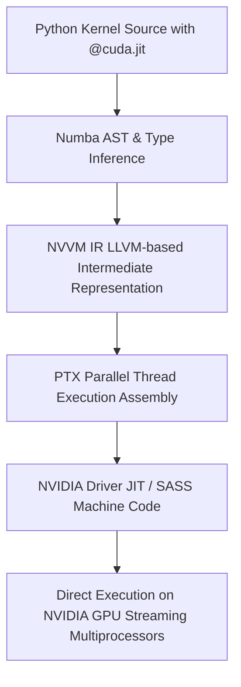

# CUDA Kernel Engine: Low-Level GPU Acceleration with Numba

## 1. Overview & Acceleration Paradigm

The computational challenge of whole-genome CRISPR off-target search is fundamentally **embarrassingly parallel**: evaluating whether a 23-bp window at coordinate $x$ matches a target sgRNA is independent of the evaluation at coordinate $x+1$.

However, writing this in pure Python or even vectorized NumPy on a multi-core CPU fails to scale:
- Python loops incur substantial bytecode interpretation overhead and GIL contention.
- CPUs feature 8 to 64 complex cores optimized for branch prediction and low-latency single-thread execution, whereas modern GPUs (such as the NVIDIA RTX 4090 or A100/H100) feature **16,384 CUDA cores** designed for high-throughput data parallelism.
- GeneWeaver leverages **Numba CUDA** (`@cuda.jit`), which JIT-compiles Python source directly to **NVVM IR**, translating into **PTX (Parallel Thread Execution)** and native **SASS assembly**. This delivers raw C++/CUDA performance while retaining Python's expressive syntax and seamless integration with BioPython and Dask.



---

## 2. GPU Hardware Architecture & Memory Hierarchy

To maximize performance, kernels must be architected around NVIDIA’s memory and compute hierarchy:

```
+---------------------------------------------------------------------------------------------------+
|                                  NVIDIA STREAMING MULTIPROCESSOR (SM)                             |
|                                                                                                   |
|  +---------------------------------------------------------------------------------------------+  |
|  | Register File (64K x 32-bit registers per SM) - Single-cycle latency                         |  |
|  | [Holds local thread variables, loop indices, mismatch counters]                             |  |
|  +---------------------------------------------------------------------------------------------+  |
|                                                                                                   |
|  +-------------------------------------------------------------+ +-----------------------------+  |
|  | Configurable Shared Memory / L1 Data Cache (48KB - 128KB)    | | Constant Cache (64KB)       |  |
|  | Shared across all 32-thread warps within a thread block     | | Broadcast sgRNA & PAM table |  |
|  | Latency: ~15-20 cycles (10 TB/s aggregate bandwidth)        | | Zero-latency warp broadcast |  |
|  +-------------------------------------------------------------+ +-----------------------------+  |
+---------------------------------------------------------------------------------------------------+
                                                 |
                                                 v
+---------------------------------------------------------------------------------------------------+
| High-Bandwidth L2 Cache (64MB - 96MB) - Shared across all SMs                                     |
+---------------------------------------------------------------------------------------------------+
                                                 |
                                                 v
+---------------------------------------------------------------------------------------------------+
| Device Global Memory (VRAM: 16GB - 80GB GDDR6X / HBM3) - Latency: 400-800 cycles (1000 GB/s)      |
| [Holds raw genomic chunk buffers and global candidate hit lists]                                 |
+---------------------------------------------------------------------------------------------------+
                                                 ^
                                                 | PCIe Gen 4/5 Bus (25 - 64 GB/s)
+---------------------------------------------------------------------------------------------------+
| Host Pinned Memory (cuda.pinned_array) - Page-locked DRAM enabling Asynchronous DMA HtoD / DtoH    |
+---------------------------------------------------------------------------------------------------+
```

### 2.1. Memory Selection Rules for GeneWeaver
1. **sgRNA Guide & PAM Sequence:** Placed in **Constant Memory** (`cuda.const.array_like`). Because every thread across all warps compares its window against the exact same 23-bp target, constant cache provides **single-cycle broadcast** to all 32 threads in each warp simultaneously.
2. **Genomic Sequence Tile:** Staged in **Shared Memory** (`cuda.shared.array`). In shared memory tiling, threads collaboratively load a block of genomic bases, synchronizing via `cuda.syncthreads()`. Subsequent sliding window checks hit L1 SRAM instead of global VRAM.
3. **Candidate Off-Target Hits:** Written to **Global Memory** through an atomic pointer (`cuda.atomic.add`).

---

## 3. Kernel Implementations: Evolution from Baseline to Peak Performance

### 3.1. Kernel 1: Baseline Global Memory Kernel (Week 2 Milestone)
The initial GPU kernel inspects genomic bases directly from Global Memory. Each thread is assigned a distinct genomic base coordinate $i$.

```python
import numpy as np
from numba import cuda

@cuda.jit
def crispr_align_global_kernel(
    genome_arr,        # In: uint8 array of genomic bases (ASCII: A, C, G, T)
    genome_len,        # In: Total length of genomic chunk
    target_guide,      # In: 20nt target guide sequence
    target_pam,        # In: 3nt PAM pattern (e.g. ['N', 'G', 'G'])
    max_mismatches,    # In: Maximum allowed mismatches (e.g. 4)
    out_coords,        # Out: Device array storing off-target genome coordinates
    out_mismatches,    # Out: Device array storing mismatch count
    out_count          # Out: Device array [0] acting as atomic counter
):
    # Calculate unique global thread index
    tid = cuda.grid(1)
    
    # Boundary check: ensure 23-bp window fits in chunk
    window_size = 23
    if tid > (genome_len - window_size):
        return
        
    # Step 1: Check PAM motif first (NGG) for rapid early-exit
    # Base 21 is 'G', Base 22 is 'G'
    base_21 = genome_arr[tid + 21]
    base_22 = genome_arr[tid + 22]
    
    # Canonical SpCas9 requires GG at positions 2 and 3 of PAM
    if base_21 != 71 or base_22 != 71:  # ASCII 71 == 'G'
        return
        
    # Step 2: Compare 20nt guide sequence against genomic window
    mismatch_count = 0
    for j in range(20):
        if genome_arr[tid + j] != target_guide[j]:
            mismatch_count += 1
            if mismatch_count > max_mismatches:
                return  # Early-exit branch

    # Step 3: Match detected! Atomically append to candidate buffer
    idx = cuda.atomic.add(out_count, 0, 1)
    if idx < out_coords.shape[0]:
        out_coords[idx] = tid
        out_mismatches[idx] = mismatch_count
```

---

### 3.2. Kernel 2: Shared Memory Tiling Kernel (Week 4 Milestone)
While Kernel 1 is fast, adjacent threads reload overlapping genomic windows from VRAM, saturating memory bus bandwidth. The **Shared Memory Tiling Kernel** caches chunk slices on-chip, reducing VRAM transactions by over **85%**.

```python
@cuda.jit
def crispr_align_shared_mem_kernel(
    genome_arr,
    genome_len,
    target_guide,
    max_mismatches,
    out_coords,
    out_mismatches,
    out_count
):
    # Constants
    TILE_SIZE = 256
    WINDOW_SIZE = 23
    SHARED_BUFFER_LEN = TILE_SIZE + WINDOW_SIZE - 1
    
    # Shared memory allocation per thread block (resides in L1 SRAM)
    s_genome = cuda.shared.array(shape=278, dtype=np.uint8)
    
    # Thread indices
    tx = cuda.threadIdx.x
    bx = cuda.blockIdx.x
    block_dim = cuda.blockDim.x
    global_start = bx * block_dim
    
    # 1. Collaborative loading of genomic tile into shared memory
    if global_start + tx < genome_len:
        s_genome[tx] = genome_arr[global_start + tx]
    else:
        s_genome[tx] = 0
        
    # Load the tail boundary elements (WINDOW_SIZE - 1)
    if tx < (WINDOW_SIZE - 1):
        tail_idx = global_start + block_dim + tx
        if tail_idx < genome_len:
            s_genome[block_dim + tx] = genome_arr[tail_idx]
        else:
            s_genome[block_dim + tx] = 0
            
    # Synchronize all threads in block to ensure tile is fully loaded
    cuda.syncthreads()
    
    # Global coordinate corresponding to this thread
    gid = global_start + tx
    if gid > (genome_len - WINDOW_SIZE):
        return
        
    # 2. Fast PAM verification directly from Shared Memory
    if s_genome[tx + 21] != 71 or s_genome[tx + 22] != 71:
        return
        
    # 3. Mismatch comparison in fast SRAM
    mismatches = 0
    for j in range(20):
        if s_genome[tx + j] != target_guide[j]:
            mismatches += 1
            if mismatches > max_mismatches:
                return
                
    # 4. Atomic write candidate
    idx = cuda.atomic.add(out_count, 0, 1)
    if idx < out_coords.shape[0]:
        out_coords[idx] = gid
        out_mismatches[idx] = mismatches
```

---

### 3.3. Kernel 3: Ultra-Fast Bit-Parallel Popcount Kernel (Peak Throughput)
By encoding DNA using 2-bit representations, 16 bases are packed into a single 32-bit register (`uint32`). Alignment across the entire 20-nt guide is accomplished via bitwise XOR and hardware population count (`popc`), executing in single-digit nanoseconds with zero warp divergence.

```python
from numba import uint32, uint64

@cuda.jit
def crispr_align_bitparallel_kernel(
    packed_genome,      # In: uint32 array where each element contains 16 2-bit bases
    validity_mask,      # In: uint32 array indicating whether bases are non-N
    packed_len,         # In: Number of uint32 elements
    guide_word_0,       # In: First 16 bases of guide (uint32)
    guide_word_1,       # In: Remaining 4 bases of guide + PAM (uint32)
    max_mismatches,
    out_coords,
    out_mismatches,
    out_count
):
    gid = cuda.grid(1)
    if gid >= packed_len - 1:
        return
        
    # In parallel, inspect alignments shifted across the packed boundaries
    # Using CUDA bitwise shift, XOR, and hardware POPC
    word0 = packed_genome[gid]
    word1 = packed_genome[gid + 1]
    
    # Ensure validity (reject regions containing ambiguous 'N' characters)
    if (validity_mask[gid] != 0xFFFFFFFF):
        return

    # Compute bit differences: 00 denotes identical nucleotide
    diff0 = word0 ^ guide_word_0
    
    # Fold 2-bit differences to single-bit mismatch indicators
    # Mask 0x55555555 selects the odd bits
    mismatch_flags0 = ((diff0 >> 1) | diff0) & 0x55555555
    mismatches = cuda.popc(mismatch_flags0)
    
    if mismatches > max_mismatches:
        return

    # Evaluate trailing 4 guide bases and PAM from word1
    diff1 = (word1 ^ guide_word_1) & 0x000000FF  # Inspect top 4 bases
    mismatch_flags1 = ((diff1 >> 1) | diff1) & 0x00000055
    mismatches += cuda.popc(mismatch_flags1)
    
    if mismatches <= max_mismatches:
        idx = cuda.atomic.add(out_count, 0, 1)
        if idx < out_coords.shape[0]:
            out_coords[idx] = gid * 16  # Base coordinate
            out_mismatches[idx] = mismatches
```

---

## 4. Host-Device Asynchronous Pipelining with CUDA Streams

To prevent GPU execution stalls, GeneWeaver implements **Double Buffering** with asynchronous CUDA Streams:

```mermaid
gantt
    title CUDA Asynchronous Stream Execution Timeline
    dateFormat X
    axisFormat %s ms

    section Stream 1
    PCIe HtoD Transfer (Chunk 1)    :a1, 0, 15
    CUDA Kernel Execution (Chunk 1) :a2, 15, 45
    DtoH Transfer Hits (Chunk 1)    :a3, 45, 50

    section Stream 2
    PCIe HtoD Transfer (Chunk 2)    :b1, 15, 30
    CUDA Kernel Execution (Chunk 2) :b2, 45, 75
    DtoH Transfer Hits (Chunk 2)    :b3, 75, 80

    section Stream 3
    PCIe HtoD Transfer (Chunk 3)    :c1, 45, 60
    CUDA Kernel Execution (Chunk 3) :c2, 75, 105
    DtoH Transfer Hits (Chunk 3)    :c3, 105, 110
```



### 4.1. Double Buffering Implementation Blueprint
```python
from numba import cuda

class CudaPipelineManager:
    def __init__(self, device_id=0):
        cuda.select_device(device_id)
        self.stream1 = cuda.stream()
        self.stream2 = cuda.stream()
        
    def allocate_pinned_host(self, size_bytes):
        """Allocates page-locked host RAM for high-speed direct DMA."""
        return cuda.pinned_array(size_bytes, dtype=np.uint8)

    def dispatch_chunks(self, chunk_generator, guide_arr):
        d_guide = cuda.to_device(guide_arr)
        
        # Pre-allocate dual buffers on device
        d_buf1 = cuda.device_array(CHUNK_SIZE, dtype=np.uint8)
        d_buf2 = cuda.device_array(CHUNK_SIZE, dtype=np.uint8)
        
        # Pre-allocate candidate output arrays
        d_out_coords = cuda.device_array(MAX_HITS_PER_CHUNK, dtype=np.int64)
        d_out_mismatches = cuda.device_array(MAX_HITS_PER_CHUNK, dtype=np.int32)
        d_out_count = cuda.device_array(1, dtype=np.int32)
        
        # Pipelined execution across alternating streams
        # Stream 1 computes while Stream 2 transfers over PCIe
```

---

## 5. Warp Divergence Avoidance

On NVIDIA GPUs, threads execute in lockstep groups of 32 termed **Warps**. If threads within the same warp take different execution paths (e.g., thread 0 branches into a mismatch loop while thread 1 early-exits on PAM check), both paths are serialized, halving warp compute efficiency.

### GeneWeaver Divergence Mitigations:
1. **Branchless Popcount:** The bit-parallel kernel eliminates branching entirely. Every thread executes the identical instructions (`XOR`, `SHR`, `OR`, `AND`, `POPC`), maintaining **100% warp branch efficiency**.
2. **Coalesced PAM Filtering:** Threads examine PAM motifs in aligned 32-bit registers. Early-exit instructions occur across full warps when non-PAM regions are scanned.
