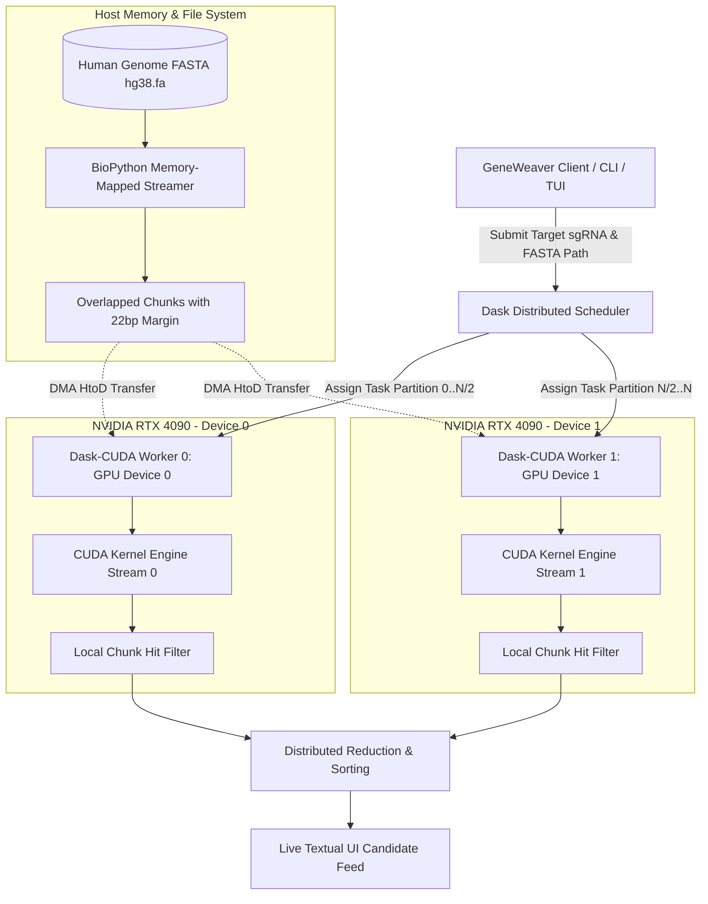

# Distributed Pipeline & Multi-GPU Orchestration with Dask

## 1. Architectural Need for Distributed Computing

While a single modern GPU (such as an NVIDIA RTX 4090 or A100) provides immense compute throughput, clinical workflows and high-throughput CRISPR screens demand scaling across:
1. **Multi-GPU Workstations:** Systems equipped with 2 to 8 GPUs.
2. **HPC Compute Clusters:** Distributed SLURM/PBS clusters where nodes are equipped with heterogeneous accelerators.
3. **Genomic Scale Beyond Single-Device VRAM:** The human genome ($3.2\text{ Gb}$) along with coordinate metadata, intermediate scoring tables, and reverse-complement strands requires distributed memory management to prevent out-of-memory bottlenecks.

GeneWeaver adopts **Dask** and **Dask-CUDA** as its distributed coordination backbone, providing dynamic task scheduling, NUMA-aware GPU worker binding, and non-blocking asynchronous pipelining.



---

## 2. Genomic Chunking Strategy & The Boundary Seam Problem

### 2.1. The Boundary Seam Vulnerability
In naive chunking, dividing a sequence into discrete chunks $[0, C)$, $[C, 2C)$, $[2C, 3C)$ causes an off-target binding site spanning the seam (e.g. from index $C-10$ to $C+13$) to be truncated across two independent GPU jobs. Neither GPU kernel will see the complete 23-bp target motif, causing a **false negative** that could compromise clinical safety.

```
Naive Chunking (Boundary Seam Loss):
Chunk 0: [ . . . . . . . . . . . . . . . A T G C C G A T ] (Ends at C-1)
Chunk 1: [ C G A T T A A C G G . . . . . . . . . . . . ] (Starts at C)
Target 23bp:           [ A T G C C G A T C G A T T A A C G G ]  <-- MISSED!
```

### 2.2. GeneWeaver Overlapped Window Chunking
To guarantee zero missed alignments, GeneWeaver appends an overlap margin $\Delta$ to every chunk:

$$\Delta = L_{\text{guide}} + L_{\text{PAM}} - 1 = 20 + 3 - 1 = 22\text{ base pairs}$$

Each chunk $k$ of base size $S$ is sliced with window coordinates:
$$\text{Start}_k = k \times S$$
$$\text{End}_k = \min\big((k + 1) \times S + \Delta, \ L_{\text{chromosome}}\big)$$

```
GeneWeaver Overlapped Chunking (Zero Misses Guaranteed):
Chunk k:   [ Base (k*S) . . . . . . . . . . . Base ((k+1)*S - 1) | OVERLAP (22bp) ]
Chunk k+1:                                                       [ Base ((k+1)*S) . . . ]
                                                                 ^ No seams missed!
```

### 2.3. Coordinate Remapping Equation
When a thread on GPU worker $k$ reports an off-target hit at local chunk offset $\ell$, the distributed reducer recalculates the exact chromosomal position:

$$\text{GlobalCoordinate} = (k \times S) + \ell$$

If an alignment begins at local index $\ell > S$, it is ignored by chunk $k$ because it is inherently captured as the leading base ($\ell - S$) of chunk $k+1$, eliminating duplicate reporting.

---

## 3. Dask-CUDA Cluster Initialization & NUMA Binding

Modern dual-socket workstation motherboards connect GPU devices to specific CPU sockets (NUMA nodes). Dispatching memory buffers from a CPU core on Socket 0 to a GPU connected to PCIe lanes on Socket 1 incurs costly inter-socket UPI/QPI bus traversals, degrading PCIe bandwidth from $25\text{ GB/s}$ down to under $8\text{ GB/s}$.

GeneWeaver configures `dask_cuda.LocalCUDACluster` to enforce **NUMA affinity and device locking**:

```python
import os
from dask.distributed import Client
from dask_cuda import LocalCUDACluster
import pynvml

def init_geneweaver_cluster(device_ids=None, memory_limit="auto"):
    """
    Spawns an optimized, NUMA-pinned Dask-CUDA cluster.
    """
    pynvml.nvmlInit()
    available_gpus = pynvml.nvmlDeviceGetCount()
    
    if device_ids is None:
        device_ids = list(range(available_gpus))
        
    print(f"[GeneWeaver Cluster] Detected {available_gpus} NVIDIA GPU(s).")
    print(f"[GeneWeaver Cluster] Binding Dask workers to GPUs: {device_ids}")
    
    # Configure Dask-CUDA cluster
    cluster = LocalCUDACluster(
        CUDA_VISIBLE_DEVICES=",".join(str(d) for d in device_ids),
        memory_limit=memory_limit,
        device_memory_limit=0.80,    # Cap GPU memory usage at 80% to prevent driver OOM
        local_directory="./tmp/dask_scratch",
        shared_filesystem=True,
        enable_nvlink=True,          # Accelerate peer-to-peer if NVLink bridges are present
        rmm_pool_size="4GB"          # Pre-allocate RAPIDS memory pool for instant allocations
    )
    
    client = Client(cluster)
    print(f"[GeneWeaver Cluster] Dashboard accessible at: {client.dashboard_link}")
    return cluster, client
```

---

## 4. The Distributed Task Graph (DAG) Execution Model

The end-to-end alignment pipeline is constructed as a lazy **Dask Directed Acyclic Graph (DAG)**:

```python
import dask
from dask import delayed
import numpy as np

@delayed
def task_parse_encode_chunk(fasta_path, offset_bytes, chunk_length):
    """Worker task: reads chunk directly from disk and converts to 2-bit binary."""
    from geneweaver.parser.bit_encoder import encode_fasta_slice
    packed_array, validity_mask, seq_meta = encode_fasta_slice(
        fasta_path, offset_bytes, chunk_length, overlap=22
    )
    return packed_array, validity_mask, seq_meta

@delayed
def task_gpu_align_chunk(packed_data, target_guide_bits, max_mismatches):
    """Worker task: transfers chunk to bound GPU, runs CUDA kernel, returns hits."""
    from numba import cuda
    from geneweaver.cuda.bit_parallel import dispatch_bitparallel_kernel
    
    packed_array, validity_mask, seq_meta = packed_data
    # This executes on the GPU assigned to this specific Dask worker
    raw_hits = dispatch_bitparallel_kernel(
        packed_array, validity_mask, target_guide_bits, max_mismatches
    )
    return raw_hits, seq_meta

@delayed
def task_score_and_filter(gpu_hits, hsu_matrix, threshold=0.01):
    """Worker task: computes biological cleavage score on hits; discards benign noise."""
    from geneweaver.biology.hsu_zhang import score_candidates
    candidates, seq_meta = gpu_hits
    scored_results = score_candidates(candidates, seq_meta, hsu_matrix, threshold)
    return scored_results

def build_alignment_dag(fasta_file, chunk_plan, target_guide, max_mismatches):
    """Assembles the full genome alignment task graph."""
    delayed_results = []
    
    for plan in chunk_plan:
        # Step 1: Delayed read & 2-bit pack
        encoded = task_parse_encode_chunk(fasta_file, plan['byte_offset'], plan['length'])
        # Step 2: Delayed GPU kernel execution
        hits = task_gpu_align_chunk(encoded, target_guide, max_mismatches)
        # Step 3: Delayed biological scoring
        scored = task_score_and_filter(hits, target_guide)
        delayed_results.append(scored)
        
    return delayed_results
```

---

## 5. Dynamic Workload Balancing Across Heterogeneous GPUs

In clinical lab environments, workstations often pair a primary workstation card (e.g. RTX 4090, 24 GB VRAM) with a secondary utility card (e.g. RTX 3080, 10 GB VRAM). Naive 50/50 static partitioning would cause the RTX 3080 to become the critical path bottleneck while the RTX 4090 sits idle.

### GeneWeaver Weighted Work-Stealing Strategy:
1. **Capability Weighting:** Each GPU worker publishes its compute capacity factor $W_g$:
   $$W_g = \text{SM\_Count} \times \text{ClockRate} \times \left(\frac{\text{VRAM}_{\text{free}}}{\text{VRAM}_{\text{total}}}\right)$$
2. **Chunk Grain Sizing:** Rather than creating only 2 large chunks for 2 GPUs, GeneWeaver segments the genome into **hundreds of fine-grained partitions** (e.g., $10\text{ MB}$ to $50\text{ MB}$ slices).
3. **Dynamic Work Stealing:** Dask dynamically pulls pending tasks from the central queue as workers complete previous chunks. The faster GPU naturally processes 70% of the partitions, while the slower GPU finishes the remaining 30%, completing the entire job in minimal wall-clock time.
