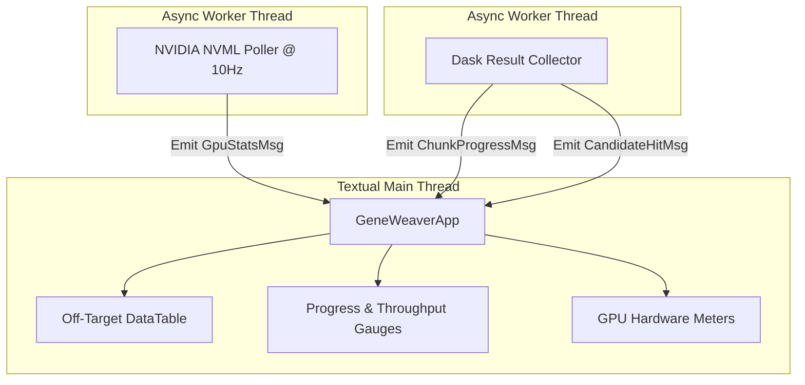

# TUI Dashboard Architecture: Reactive Terminal UI with Textual

## 1. Design Philosophy & User Experience

In high-performance genomics, researchers typically execute jobs on remote GPU servers via headless SSH connections. Traditional GUI frameworks (such as Qt, Electron, or Web browsers) introduce heavy dependencies, X11 forwarding lag, and security surface vulnerabilities.

GeneWeaver provides a **Terminal User Interface (TUI)** built with **Textual** (powered by Rich). The TUI combines:
- **Zero Headless Friction:** Runs natively inside any terminal emulator (iTerm2, Windows Terminal, Alacritty, GNOME Terminal) over standard SSH.
- **Real-Time Reactive State:** Powered by an asynchronous Python event loop (asyncio) updating at 60 FPS without blocking GPU compute.
- **Hardware Telemetry Integration:** Direct integration with the NVIDIA Management Library (`pynvml`), tracking VRAM, core clocks, temperature, and PCIe throughput.
- **Biologically Actionable Visuals:** ANSI 24-bit TrueColor rendering highlighting DNA mismatches, PAM motifs, and cutting probability risk tiers.

---

## 2. Terminal UI Wireframe & Layout Blueprint

```
+---------------------------------------------------------------------------------------------------+
| GeneWeaver v1.0.0 | GPU-Accelerated CRISPR Engine | Target: ATGCGATCGATCGAACGTAC (PAM: NGG)      |
+---------------------------------------------------------------------------------------------------+
| GPU 0: NVIDIA RTX 4090 [■■■■■■■■■■■■■■■■■■■■ 98%] 67°C | VRAM: 4.8 GB / 24.0 GB (Pinned: 1.2GB)    |
| GPU 1: NVIDIA RTX 4090 [■■■■■■■■■■■■■■■■■■■■ 97%] 65°C | VRAM: 4.7 GB / 24.0 GB (Pinned: 1.2GB)    |
| Global Throughput: 18.4 Million bp/s | Elapsed: 00:01:42 | ETA: 00:01:14                          |
+---------------------------------------------------------------------------------------------------+
| CHUNKING & ALIGNMENT PROGRESS                                                                     |
| Total Genome: [██████████████████████████████████████░░░░░░░░░░░░░░] 64.2% (2.05 / 3.20 Gb)      |
| Current Task: chr7 (p-arm) | Active Dask Workers: 2 | Off-Target Hits Found: 1,482                |
+---------------------------------------------------------------------------------------------------+
| REAL-TIME OFF-TARGET CANDIDATES (Ranked by Hsu-Zhang Cleavage Probability)                        |
| Locus           Strand  Mismatches  Hsu Score  CFD Score  Aligned Sequence (Mutations in Red)     |
| ------------------------------------------------------------------------------------------------- |
| chr7:142,509,211  (+)       1         0.842      0.912    A T G C [G] A T C G A T C G A A C G T A C  A G G |
| chr3:084,112,904  (-)       2         0.485      0.531    A [C] G C G A T C G A T C [T] A A C G T A C  T G G |
| chr11:002,410,512 (+)       2         0.391      0.410    A T G C G A T C [T] A T C G A A C [A] T A C  G G G |
| chrX:049,182,340  (+)       3         0.114      0.155    A [A] G C [T] A T C G A T C [T] A A C G T A C  A G G |
| chr2:188,901,230  (-)       4         0.038      0.041    [C] T G C G [T] T C G A [A] C G A A C G [C] A C  C G G |
+---------------------------------------------------------------------------------------------------+
| DETAIL INSPECTION PANEL: chr7:142,509,211 (+)                                                     |
|                                                                                                   |
| Target:    5' - A T G C  G  A T C G A T C G A A C G T A C   N G G - 3'                            |
| Off-Target:5' - A T G C [G] A T C G A T C G A A C G T A C   A G G - 3'                            |
|                          |                                   | |                                  |
| Mismatch:             Pos 5 (G->A: Distal)                 PAM (AGG)                              |
| Cleavage Prediction:  HIGH RISK (Exon 4, Oncogene BRAF Homolog)                                  |
+---------------------------------------------------------------------------------------------------+
| [Q] Quit | [P] Pause Scan | [E] Export CSV/VCF | [V] Toggle VRAM Graph | [↑/↓] Select Hit         |
+---------------------------------------------------------------------------------------------------+
```

---

## 3. Reactive Architecture & Async State Machine

Textual uses an event-driven message pump. GeneWeaver separates concerns into two decoupled asynchronous worker loops to prevent GPU computation or disk I/O from stuttering the user interface:



---

## 4. Implementation Specification

### 4.1. Textual Application Skeleton (`src/geneweaver/tui/app.py`)
```python
import asyncio
from textual.app import App, ComposeResult
from textual.containers import Container, Horizontal, Vertical
from textual.widgets import Header, Footer, ProgressBar, DataTable, Static, Label
from textual.reactive import reactive
import pynvml

class GpuTelemetryCard(Static):
    """Renders real-time VRAM and SM utilization for a specific GPU device."""
    vram_percent = reactive(0.0)
    gpu_util = reactive(0.0)
    temp_c = reactive(0)
    
    def __init__(self, device_index: int, **kwargs):
        super().__init__(**kwargs)
        self.device_index = device_index
        
    def render(self) -> str:
        bar_len = 20
        filled = int((self.gpu_util / 100.0) * bar_len)
        bar = "█" * filled + "░" * (bar_len - filled)
        return (
            f"[bold cyan]GPU {self.device_index}[/]: [{bar}] "
            f"[bold yellow]{self.gpu_util:3.0f}%[/] | "
            f"VRAM: [green]{self.vram_percent:3.1f}%[/] | "
            f"Temp: [red]{self.temp_c}°C[/]"
        )

class GeneWeaverApp(App):
    CSS_PATH = "styles.css"
    BINDINGS = [
        ("q", "quit", "Quit"),
        ("e", "export_results", "Export"),
        ("space", "toggle_pause", "Pause/Resume"),
    ]
    
    total_scanned_bp = reactive(0)
    total_genome_bp = reactive(3_200_000_000)
    
    def compose(self) -> ComposeResult:
        yield Header(show_clock=True)
        with Vertical(id="telemetry_container"):
            yield Label("[bold white]Hardware Telemetry (NVML)[/]")
            yield GpuTelemetryCard(device_index=0, id="gpu_0")
            yield GpuTelemetryCard(device_index=1, id="gpu_1")
            
        with Vertical(id="progress_container"):
            yield Label("[bold white]Alignment Progress[/]")
            yield ProgressBar(total=100, show_eta=True, id="main_progress")
            yield Label("Scanning...", id="status_label")
            
        with Vertical(id="table_container"):
            yield Label("[bold white]Discovered Off-Target Mutations[/]")
            yield DataTable(id="hits_table")
            
        yield Footer()

    def on_mount(self) -> None:
        table = self.query_one(DataTable)
        table.add_columns("Locus", "Strand", "Mismatches", "Hsu Score", "CFD Score", "Alignment Preview")
        table.cursor_type = "row"
        
        # Launch non-blocking telemetry poller
        self.run_worker(self.poll_nvml_loop, thread=True)

    async def poll_nvml_loop(self):
        """Dedicated thread continuously querying NVML."""
        pynvml.nvmlInit()
        handle0 = pynvml.nvmlDeviceGetHandleByIndex(0)
        
        while self.is_running:
            util = pynvml.nvmlDeviceGetUtilizationRates(handle0)
            mem = pynvml.nvmlDeviceGetMemoryInfo(handle0)
            temp = pynvml.nvmlDeviceGetTemperature(handle0, pynvml.NVML_TEMPERATURE_GPU)
            
            # Post updates to UI widgets safely via call_from_thread
            card = self.query_one("#gpu_0", GpuTelemetryCard)
            card.gpu_util = float(util.gpu)
            card.vram_percent = float(mem.used / mem.total * 100)
            card.temp_c = temp
            
            await asyncio.sleep(0.1)  # 10Hz polling
```

---

## 5. Rich Terminal Mismatch Highlighting Algorithm

When displaying candidate DNA alignments, mutations and the PAM sequence must be instantly identifiable by the researcher. GeneWeaver utilizes Rich Text markup to construct ANSI color-coded sequence spans:

```python
from rich.text import Text

def format_dna_alignment(target_guide: str, locus_seq: str, pam_str: str) -> Text:
    """
    Renders color-coded 23-bp alignment:
    - Matches: Dim cyan / white
    - Mismatches: Bold Red on Dark Red background
    - PAM motif: Bold Emerald Green
    """
    result = Text()
    
    # 20nt Guide region
    for i in range(20):
        t_base = target_guide[i]
        l_base = locus_seq[i]
        
        if t_base == l_base:
            result.append(f"{l_base} ", style="bold cyan")
        else:
            # Highlight mutation in red
            result.append(f"[{l_base}]", style="bold white on red")
            
    # Spacer
    result.append("  ")
    
    # 3nt PAM region
    result.append(f"{pam_str[0]} ", style="dim green")
    result.append(f"{pam_str[1]} ", style="bold bright_green")
    result.append(f"{pam_str[2]}", style="bold bright_green")
    
    return result
```

This formatting ensures that when a researcher reviews the TUI, off-target hotspots (especially those within the critical PAM-proximal seed region) stand out with unambiguous visual clarity.
