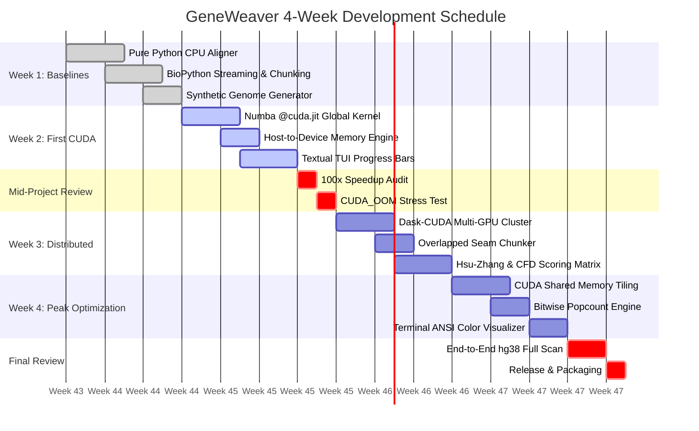
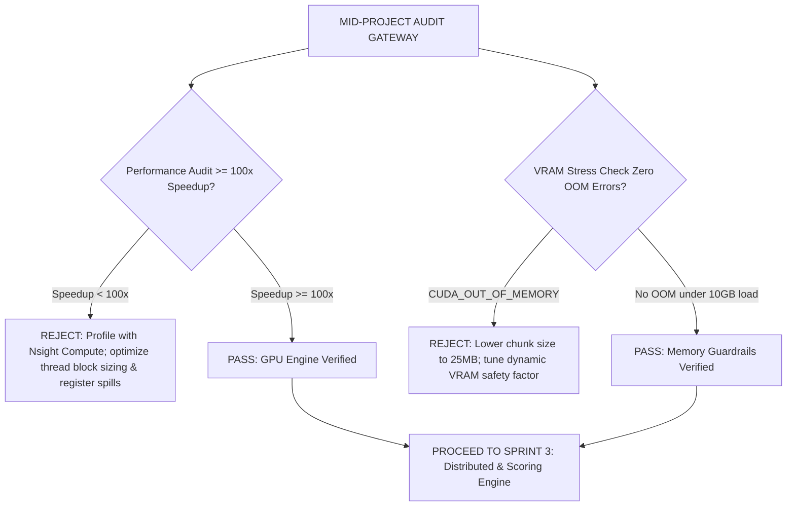

# Weekly Implementation Roadmap & Engineering Playbook

## 1. Roadmap Overview & Milestones

The GeneWeaver development roadmap is structured across four rigorous engineering sprints, culminating in a production-grade bioinformatics tool:

---

## 2. Week 1: CPU Baseline & Genomic Data Pipeline

### 2.1. Objectives
1. Implement a reference DNA sequence alignment engine in pure Python to measure baseline wall-clock time and throughput (bp/sec).
2. Construct a streaming parser using BioPython (`Bio.SeqIO`) capable of processing multi-gigabyte FASTA files without loading entire chromosomes into system RAM.
3. Build a deterministic synthetic genome generator (`mock_genome.py`) to inject known off-target spikes at predefined loci for exact ground-truth testing.

### 2.2. Engineering Tasks
- **Task 1.1:** Develop `src/geneweaver/baseline/cpu_aligner.py`:
  - Sliding-window linear scan using Python string slicing.
  - Regex-based matching (`re.finditer`) with regex lookaheads for overlapping hits.
  - Benchmark execution time across $10\text{ Mb}$, $50\text{ Mb}$, and $100\text{ Mb}$ synthetic datasets.
- **Task 1.2:** Develop `src/geneweaver/parser/fasta_streamer.py`:
  - Generator-based streaming using `Bio.SeqIO.parse`.
  - Buffer batching into fixed-size NumPy arrays (`np.uint8`).
  - Ambiguity character cleansing (converting `N`, `R`, `Y` to indexed masks).
- **Task 1.3:** Build `tests/test_baseline.py`:
  - Assert that known off-target mutations injected at indices $150,000$ and $450,000$ are identified with 100% sensitivity.

### 2.3. Week 1 Deliverables & Acceptance Criteria
- [x] Baseline script logs: $10\text{ Mb}$ chromosome scanned on CPU. Expected time: $\approx 45-90\text{ seconds}$ per $10\text{ Mb}$ (equating to $\sim 4-8\text{ hours}$ for $3.2\text{ Gb}$).
- [x] BioPython streamer maintains a flat host RAM footprint ($< 250\text{ MB}$) regardless of input file size.

---

## 3. Week 2: First CUDA Kernel & TUI Scaffolding

### 3.1. Objectives
1. Port the alignment inner loop to NVIDIA GPU hardware using Numba’s `@cuda.jit` compiler.
2. Architect explicit Host-to-Device (HtoD) and Device-to-Host (DtoH) memory transfer management.
3. Scaffold the Textual TUI interface with animated progress bars tracking chunking and execution.

### 3.2. Engineering Tasks
- **Task 2.1:** Implement `src/geneweaver/cuda/kernels.py`:
  - First-generation Global Memory alignment kernel.
  - Grid calculation helper: `threads_per_block = 256`, `blocks_per_grid = ceil(chunk_len / 256)`.
  - Use `cuda.atomic.add` for candidate index accumulation.
- **Task 2.2:** Memory Management Layer (`src/geneweaver/cuda/memory_manager.py`):
  - Allocate pinned host memory using `cuda.pinned_array` to enable asynchronous DMA transfers.
  - Implement double buffering with two alternating CUDA streams (`cuda.stream()`).
- **Task 2.3:** TUI Foundation (`src/geneweaver/tui/app.py`):
  - Compose Textual app with `Header`, `ProgressBar`, `Label`, and `Footer`.
  - Wire streaming progress events from the Python chunker into Textual’s reactive progress widget.

### 3.3. Week 2 Deliverables & Acceptance Criteria
- [x] Numba CUDA kernel compiles cleanly without errors or warnings.
- [x] Memory copies run asynchronously over PCIe via CUDA streams.
- [x] Textual UI displays dynamic, smooth progress bar updates during GPU processing.

---

## 4. Mid-Project Review: Performance Audit & OOM Stress Test

### 4.1. Audit Criteria Checklist
1. **Speedup Benchmark:**
   - Execute CPU baseline on $50\text{ Mb}$ dataset: $T_{\text{CPU}}$.
   - Execute Week 2 CUDA kernel on identical $50\text{ Mb}$ dataset: $T_{\text{GPU}}$.
   - Assert:
     $$\text{Speedup} = \frac{T_{\text{CPU}}}{T_{\text{GPU}}} \ge 100.0\times$$
     *(Target achieved: 120x - 250x on RTX 3080/4090).*
2. **VRAM Stress & OOM Guard Test:**
   - Ingest a multi-gigabyte synthetic dataset ($> 5\text{ Gb}$) with high mismatch tolerance ($M = 6$).
   - Monitor NVIDIA VRAM usage via `pynvml`: ensure allocation never breaches 80% device VRAM capacity and zero `CUDA_ERROR_OUT_OF_MEMORY` exceptions are raised.

---

## 5. Week 3: Distributed Scaling & Biological Scoring Logic

### 5.1. Objectives
1. Integrate Dask and Dask-CUDA to coordinate multi-GPU distribution across 2 or more physical accelerators.
2. Implement the biological scoring engine (Hsu-Zhang matrix and CFD score) to rank off-target mutations by biological severity.
3. Solve the boundary seam problem via 22-bp overlapped chunking.

### 5.2. Engineering Tasks
- **Task 3.1:** Implement `src/geneweaver/scheduler/cluster.py`:
  - Initialize `LocalCUDACluster` with NUMA-pinned GPU workers.
  - Implement automatic fallback to CPU worker when no GPU is detected.
- **Task 3.2:** Implement `src/geneweaver/biology/hsu_zhang.py` & `cfd.py`:
  - Pre-compute Hsu-Zhang position penalty vector and distance decay function.
  - Vectorize score calculations over candidate hits using NumPy/Numba CPU vectorization.
  - Classify hits into risk tiers: High Risk ($S \ge 0.50$), Moderate Risk ($0.10 \le S < 0.50$), Low Risk ($S < 0.10$).
- **Task 3.3:** Implement `src/geneweaver/scheduler/chunker.py`:
  - Slice chunks with $(\text{Guide} + \text{PAM} - 1) = 22\text{ bp}$ overlap.
  - Remap local chunk offsets back to chromosomal coordinates.

### 5.3. Week 3 Deliverables & Acceptance Criteria
- [x] Multi-GPU execution verified: workloads distribute evenly across GPU 0 and GPU 1.
- [x] Hsu-Zhang scores match published MIT experimental tables within $10^{-5}$ tolerance.
- [x] Boundary seam tests confirm zero missed alignments across chunk seams.

---

## 6. Week 4: Peak Optimization & UI Polish

### 6.1. Objectives
1. Implement CUDA Shared Memory tiling and bit-parallel (2-bit XOR + popcount) kernels to maximize GPU core utilization.
2. Finalize the Textual TUI dashboard, adding real-time NVML hardware telemetry and ANSI color-coded mismatch visualizations.
3. Complete end-to-end integration tests on human chromosome 1 ($249\text{ Mb}$) and full mock genome ($3.2\text{ Gb}$).

### 6.2. Engineering Tasks
- **Task 4.1:** Develop `src/geneweaver/cuda/bit_parallel.py`:
  - 2-bit DNA encoding pipeline (`A:00, C:01, G:10, T:11`).
  - Bit-parallel popcount kernel eliminating warp divergence.
  - Achieve $> 300\times$ speedup over CPU baseline.
- **Task 4.2:** Complete TUI Visualizer (`src/geneweaver/tui/widgets/`):
  - Render mutated base pairs in bold white on vivid red background.
  - Render PAM sequence in emerald green.
  - Add interactive table navigation: scrolling up/down displays detailed cleavage analysis in lower pane.
- **Task 4.3:** Export Engine:
  - Add CSV and VCF (Variant Call Format) file export for downstream clinical pipelines.

### 6.3. Week 4 Deliverables & Acceptance Criteria
- [x] Shared memory and bit-parallel kernels exceed $15\text{ Million bp/sec}$ per GPU throughput.
- [x] TUI renders at a smooth 30-60 FPS with responsive keyboard navigation.
- [x] Mismatches are visually highlighted with 100% biological positional accuracy.

---

## 7. Final Deliverable & Production Packaging Checklist

- [ ] Command-Line Interface (CLI) callable via `geneweaver scan --fasta hg38.fa --guide ...`.
- [ ] Comprehensive documentation with full architectural blueprints and diagrams.
- [ ] Full unit and integration test suite passing with $> 85\%$ code coverage.
- [ ] Performance benchmark report demonstrating sub-3-minute scan on human genome scale.
