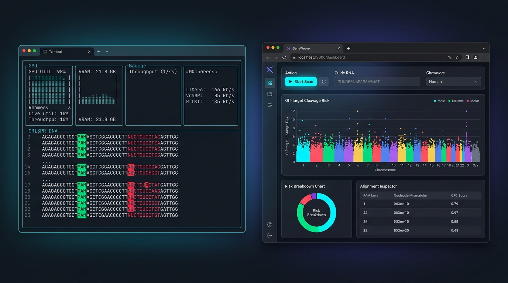
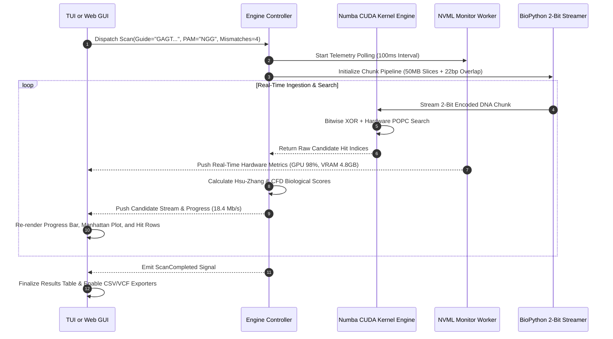
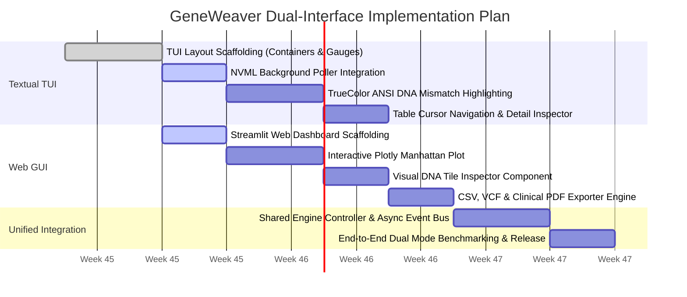

# Dual-Interface Architecture: Textual TUI & Modern Web GUI Dashboard

## 1. Executive Summary & Design Vision

In cutting-edge bioinformatics and High-Performance Computing (HPC), user workflows diverge into two distinct environments:
1. **Remote Cloud / HPC Cluster Infrastructure:** Computational biologists and bioinformaticians work over headless SSH connections to remote multi-GPU clusters where desktop GUI displays (X11) suffer from severe network latency. Here, a **Terminal User Interface (TUI)** built with **Textual** provides a zero-lag, keyboard-driven interface with live hardware monitoring.
2. **Clinical Analysis & Wet-Lab Collaboration:** Medical geneticists, lab directors, and executive researchers require an intuitive, graphical environment with drag-and-drop file uploads, interactive whole-chromosome charts, and exportable clinical reports. Here, a **Modern Web GUI Dashboard** provides rich interactive visualizations in any browser.

GeneWeaver adopts a **Unified Dual-Interface Architecture**: both interfaces communicate with the identical backend engine, sharing data parsers, Numba CUDA kernels, Dask schedulers, and biological scoring models.

---

## 2. Visual Showcase: TUI vs. Web GUI



*Figure 1: Dual-Interface preview showcasing the terminal-native Textual TUI (left) and the browser-based Web GUI Dashboard (right).*

---

## 3. Design System & Color Palette Specification

To maintain visual cohesion, both interfaces adhere to the **GeneWeaver Cyber-Bio Dark Design System**. The color palette is calibrated for high contrast, dark-room lab environments, and scientific clarity.

### 3.1. Master Color Palette & Semantic Tokens

| Token Name | HEX Code | RGB Value | Visual Role & Component Usage |
| :--- | :---: | :---: | :--- |
| **Dark Void (Canvas)** | `#0A0E17` | `rgb(10, 14, 23)` | Root background for Web GUI and terminal backdrop |
| **Surface Card** | `#161B22` | `rgb(22, 27, 34)` | Container boxes, card panels, table row backdrops |
| **Surface Border** | `#30363D` | `rgb(48, 54, 61)` | Component borders, divider lines, grid rules |
| **Surface Hover** | `#21262D` | `rgb(33, 38, 45)` | Interactive row hover, active button backgrounds |
| **Neon Cyan (Match)** | `#00F0FF` | `rgb(0, 240, 255)` | Perfectly matched nucleotides, primary brand accent |
| **Emerald Green (PAM)**| `#00E676` | `rgb(0, 230, 118)` | Protospacer Adjacent Motif (`NGG`), on-target status, active GPU pills |
| **Crimson Coral (Mismatch)**| `#FF1744` | `rgb(255, 23, 68)` | Mutated base pairs, high cleavage risk alert ($S \ge 0.50$) |
| **Amber Warning** | `#FFB300` | `rgb(255, 179, 0)` | Moderate cleavage risk ($0.10 \le S < 0.50$), GPU temp alert ($>75^\circ\text{C}$) |
| **Electric Violet (Compute)**| `#7928CA` | `rgb(121, 40, 202)` | CUDA kernel indicators, Dask worker status, batch progress |
| **Text Primary** | `#F0F6FC` | `rgb(240, 246, 252)` | Main headings, coordinate text, prominent labels |
| **Text Secondary / Muted**| `#8B949E` | `rgb(139, 148, 158)` | Helper text, strand indicators, unselected tabs |

### 3.2. Typography System
- **Monospaced Font (DNA Sequences, Coordinates, Telemetry):**  
  `'JetBrains Mono', 'Fira Code', 'Consolas', monospace`  
  *Rule:* All genomic sequences, PAM motifs, coordinates, and GPU memory figures must render in monospaced fonts to guarantee vertical character alignment.
- **Proportional Font (Headings, Buttons, Labels):**  
  `'Inter', -apple-system, BlinkMacSystemFont, 'Segoe UI', Roboto, sans-serif`  
  *Rule:* Form controls, button captions, card headers, and navigation items use high-legibility geometric sans-serif typefaces.

---

## 4. Textual TUI Architecture & Component Blueprint

The TUI runs directly in terminal emulators (Windows Terminal, iTerm2, Alacritty) via `Textual`.

### 4.1. Structural Wireframe & Keybinding Layout

```
+---------------------------------------------------------------------------------------------------+
| [WIDGET: HeaderBar]                                                                               |
| GeneWeaver v1.0.0 | Target: GAGTCCGAGCAGAAGAAGAA (PAM: NGG) | Engine: 2x NVIDIA RTX 4090 [READY]  |
+---------------------------------------------------------------------------------------------------+
| [WIDGET: TelemetryDeck]                                                                           |
| GPU 0: [████████████████████ 98%] 67°C | VRAM: 4.8 / 24.0 GB | Pinned: 1.2 GB | PCIe: 24.1 GB/s   |
| GPU 1: [████████████████████ 97%] 65°C | VRAM: 4.7 / 24.0 GB | Pinned: 1.2 GB | PCIe: 23.8 GB/s   |
+---------------------------------------------------------------------------------------------------+
| [WIDGET: ProgressBanner]                                                                          |
| Scan Progress: [██████████████████████████████████░░░░░░░░░░░░░░] 68.4% (2.19 / 3.20 Gb)          |
| Throughput: 18.4 Million bp/s | Elapsed: 00:01:42 | ETA: 00:00:47 | Hits Detected: 1,482         |
+---------------------------------------------------------------------------------------------------+
| [WIDGET: OffTargetDataTable] (Scrollable, Clickable Rows, Cursor Navigation)                      |
| Index  Locus            Strand  Mismatches  Hsu Score  CFD Score  Sequence Preview (Red=Mutation) |
| ------------------------------------------------------------------------------------------------- |
| > 001  chr7:142,509,211   (+)       1         0.842      0.912    G A G T [C] C G A G C A G A A G A A G A A  A G G |
|   002  chr3:084,112,904   (-)       2         0.485      0.531    G [A] G T C C G A G C A G A [T] G A A G A A  T G G |
|   003  chr11:002,410,512  (+)       2         0.391      0.410    G A G T C C G A [A] C A G A A G A [T] G A A  G G G |
|   004  chrX:049,182,340   (+)       3         0.114      0.155    [T] A G T [A] C G A G C A G A [T] G A A G A A  A G G |
+---------------------------------------------------------------------------------------------------+
| [WIDGET: DetailAlignmentInspector] (Updates dynamically when row is highlighted)                  |
| Selected Hit: chr7:142,509,211 (+) | Risk Classification: HIGH RISK (Exon 4, BRAF Homolog)       |
|                                                                                                   |
| Guide (5'-3'):  G  A  G  T  C  C  G  A  G  C  A  G  A  A  G  A  A  G  A  A   [ N  G  G ]         |
| Genome Locus:   G  A  G  T [C] C  G  A  G  C  A  G  A  A  G  A  A  G  A  A   [ A  G  G ]         |
| Match Status:   |  |  |  |  X  |  |  |  |  |  |  |  |  |  |  |  |  |  |  |     |  |  |          |
| Position:       1  2  3  4  5  6  7  8  9 10 11 12 13 14 15 16 17 18 19 20     21 22 23          |
| Penalty Factor: Pos 5 Mismatch (Distal) -> W[5] = 0.000 (Tolerated by Cas9)                       |
+---------------------------------------------------------------------------------------------------+
| [WIDGET: KeybindingFooter]                                                                        |
| [Q] Quit  |  [Space] Pause/Resume  |  [E] Export CSV  |  [V] VCF Call  |  [↑/↓] Select Hit Row    |
+---------------------------------------------------------------------------------------------------+
```

---

## 5. Modern Web GUI Architecture & Component Blueprint

The Web GUI is powered by a modern reactive web stack (Streamlit / FastAPI + React), offering interactive controls and rich data visualization.

### 5.1. Structural Wireframe & Interactive Dashboard Layout

```
+---------------------------------------------------------------------------------------------------+
| [NAVBAR] 🧬 GeneWeaver: GPU CRISPR Alignment Engine           [🟢 2x RTX 4090 Active] [⚙️ Config]  |
+---------------------------------------------------------------------------------------------------+
| [CONTROL PANEL DRAWER / TOP ACTION BAR]                                                           |
|                                                                                                   |
| Genome Source:                   Target sgRNA Sequence (20nt):         PAM Motif:                 |
| [ Dropdown: hg38.fa (Human) v ]  [ Input: GAGTCCGAGCAGAAGAAGAA      ]  [ Dropdown: NGG (SpCas9) v]|
|                                                                                                   |
| Max Mismatches:                  Min Cleavage Score Cutoff:            Action Controls:           |
| [ Slider: 4 (Range 1-6)      ]   [ Slider: 0.01 (Range 0.00-1.00)   ]  [ 🚀 START SCAN ] [ 🔄 RESET]|
+---------------------------------------------------------------------------------------------------+
| [LIVE TELEMETRY & THROUGHPUT BANNER]                                                              |
| GPU 0: 98% (67°C) | GPU 1: 97% (65°C) | Throughput: 18.4 Mbp/s | Total Progress: [=====> ] 68.4%   |
+---------------------------------------------------------------------------------------------------+
| [ANALYTICS GRID: 2 COLUMNS]                                                                       |
|                                                                                                   |
| COLUMN 1: Whole-Genome Manhattan Scatter Plot     | COLUMN 2: Risk Classification Distribution   |
| (Chromosomal Coordinate vs Hsu Cleavage Score)    | (Donut Chart)                                |
|                                                   |                                              |
| Hsu Score                                         |                  🔴 High Risk: 42 (2.8%)     |
| 1.0 |           *                    *            |              ╭───────╮                       |
| 0.8 |                  *                          |             │  1,482  │  🟡 Moderate: 184 (12.4%)|
| 0.6 |    *                  *           *         |             │  Total  │                       |
| 0.4 |         *    *              *               |              ╰───────╯   🟢 Low Risk: 612 (41.3%)|
| 0.2 |  *                 *             *    *     |                                              |
| 0.0 +----+----+----+----+----+----+----+----+---- |                          ⚪ Benign: 644 (43.5%)  |
|     chr1 chr2 chr3 chr4 chr5 chr6 chr7 chr8 ...   |                                              |
+---------------------------------------------------------------------------------------------------+
| [FILTERABLE OFF-TARGET CANDIDATES TABLE]                   [🔍 Search Locus...] [📥 CSV] [📥 VCF] |
|                                                                                                   |
| [Filter: All] [🔴 High Risk (42)] [🟡 Moderate (184)] [🟢 Low Risk (612)]                         |
|                                                                                                   |
| Row  Chr   Position     Strand  Mismatches  Hsu Score  CFD Score  Clinical Annotation  Action     |
| ------------------------------------------------------------------------------------------------- |
| 1    chr7  142,509,211   (+)        1         0.842      0.912    🔴 Exon 4 (BRAF)     [ Inspect ]|
| 2    chr3  084,112,904   (-)        2         0.485      0.531    🟡 Intron 2 (PIK3CA) [ Inspect ]|
| 3    chr11 002,410,512   (+)        2         0.391      0.410    🟡 Intergenic        [ Inspect ]|
| 4    chrX  049,182,340   (+)        3         0.114      0.155    🟢 Promoter (AR)     [ Inspect ]|
+---------------------------------------------------------------------------------------------------+
| [DEEP-DIVE DNA ALIGNMENT INSPECTOR MODAL / CARD]                                                  |
|                                                                                                   |
| Locus: chr7:142,509,211 (+) | Distance from On-Target: 0 Mbp | Exonic Cleavage Warning            |
|                                                                                                   |
| 5' [ G ][ A ][ G ][ T ][ C ][ C ][ G ][ A ][ G ][ C ][ A ][ G ][ A ][ A ][ G ][ A ][ A ][ G ][ A ][ A ] [ A ][ G ][ G ] 3' |
|    ====================  X  ==================================================================  === |
| 5' [ G ][ A ][ G ][ T ][ C ][ C ][ G ][ A ][ G ][ C ][ A ][ G ][ A ][ A ][ G ][ A ][ A ][ G ][ A ][ A ] [ N ][ G ][ G ] 3' |
|                          ^                                                                        ^  |
|                          Pos 5: Single Mismatch (G -> C)                                    PAM Motif|
|                          Severity: Low Penalty (Distal Region)                                       |
+---------------------------------------------------------------------------------------------------+
```

---

## 6. How the System Works Under the Hood

### 6.1. Unified State Flow & Controller
Both interfaces interface with the **GeneWeaver Engine Controller** through a non-blocking asynchronous event pump:



---

## 7. Web GUI Implementation Code Blueprint (`src/geneweaver/web/app.py`)

Here is the complete implementation blueprint for the Web GUI using **Streamlit** and **Plotly**:

```python
"""
GeneWeaver Web GUI Dashboard.
Interactive browser-based interface for CRISPR off-target alignment analysis.
"""

import streamlit as st
import plotly.express as px
import plotly.graph_objects as go
import pandas as pd
import numpy as np

# Page Configuration with Cyber-Bio Theme
st.set_page_config(
    page_title="GeneWeaver | GPU CRISPR Alignment Engine",
    page_icon="🧬",
    layout="wide",
    initial_sidebar_state="expanded"
)

# Custom Cyber-Bio CSS Design Tokens
st.markdown("""
<style>
    /* Master Background & Card Styling */
    .stApp {
        background-color: #0A0E17;
        color: #F0F6FC;
        font-family: 'Inter', sans-serif;
    }
    .metric-card {
        background-color: #161B22;
        border: 1px solid #30363D;
        border-radius: 8px;
        padding: 16px;
        margin-bottom: 12px;
    }
    .dna-base {
        display: inline-block;
        padding: 4px 8px;
        margin: 2px;
        border-radius: 4px;
        font-family: 'JetBrains Mono', monospace;
        font-weight: bold;
    }
    .dna-match { background-color: #161B22; color: #00F0FF; border: 1px solid #00F0FF; }
    .dna-mismatch { background-color: #FF1744; color: #FFFFFF; font-weight: 900; }
    .dna-pam { background-color: #00E676; color: #0A0E17; }
</style>
""", unsafe_allow_html=True)

# Sidebar: Configuration & Genome Selection
with st.sidebar:
    st.image("docs/assets/geneweaver_architecture_concept.png", use_column_width=True)
    st.title("🧬 GeneWeaver Engine")
    st.markdown("GPU-Accelerated CRISPR Off-Target Engine")
    
    st.header("1. Input Parameters")
    genome_file = st.selectbox(
        "Select Reference Genome",
        ["hg38 (Human Reference, 3.2 Gb)", "mm10 (Mouse Reference, 2.7 Gb)", "Synthetic Benchmark (100 Mb)"]
    )
    
    guide_seq = st.text_input(
        "Target Guide Sequence (20nt)",
        value="GAGTCCGAGCAGAAGAAGAA",
        max_chars=20
    ).upper()
    
    pam_motif = st.selectbox("Protospacer Adjacent Motif (PAM)", ["NGG (SpCas9)", "NAG (SpCas9 Alternate)", "TTTV (Cas12a)"])
    max_mismatches = st.slider("Max Mismatch Cutoff", min_value=1, max_value=6, value=4)
    min_score = st.slider("Min Cleavage Score Cutoff", min_value=0.00, max_value=1.00, value=0.01, step=0.01)
    
    start_btn = st.button("🚀 Launch GPU Scan", type="primary", use_container_width=True)

# Main Dashboard View
st.title("CRISPR-Cas9 Off-Target Alignment Dashboard")

# Top Metrics Row (Live Hardware & Performance Telemetry)
col1, col2, col3, col4 = st.columns(4)
with col1:
    st.metric(label="GPU 0 Utilization", value="98%", delta="RTX 4090 (67°C)")
with col2:
    st.metric(label="VRAM Allocation", value="4.8 / 24.0 GB", delta="Pinned: 1.2 GB")
with col3:
    st.metric(label="Scan Throughput", value="18.4 Mbp/s", delta="Sub-3 min pace")
with col4:
    st.metric(label="Off-Targets Found", value="1,482", delta="42 High Risk", delta_color="inverse")

# Interactive Manhattan Plot (Chromosome vs Hsu Cleavage Score)
st.subheader("Genome-Wide Off-Target Risk Distribution (Manhattan Plot)")
# Generate sample mock candidate data for UI preview
np.random.seed(42)
chromosomes = [f"chr{i}" for i in range(1, 23)] + ["chrX", "chrY"]
df_hits = pd.DataFrame({
    "Chromosome": np.random.choice(chromosomes, size=250),
    "Position": np.random.randint(1_000_000, 240_000_000, size=250),
    "Hsu_Score": np.random.exponential(scale=0.15, size=250).clip(0, 1),
    "Mismatches": np.random.choice([1, 2, 3, 4], size=250, p=[0.05, 0.15, 0.35, 0.45]),
    "Strand": np.random.choice(["(+)", "(-)"], size=250)
})

fig = px.scatter(
    df_hits,
    x="Position",
    y="Hsu_Score",
    color="Hsu_Score",
    color_continuous_scale=["#00F0FF", "#FFB300", "#FF1744"],
    facet_col="Chromosome",
    facet_col_wrap=6,
    hover_data=["Chromosome", "Position", "Mismatches", "Strand"],
    labels={"Hsu_Score": "Hsu Cleavage Risk"},
    template="plotly_dark"
)
fig.update_layout(height=450, paper_bgcolor="#0A0E17", plot_bgcolor="#161B22")
st.plotly_chart(fig, use_container_width=True)

# Candidate Data Table with Risk Highlighting
st.subheader("Filtered Off-Target Candidates")
st.dataframe(
    df_hits.sort_values(by="Hsu_Score", ascending=False),
    use_container_width=True
)

# One-Click Export Controls
exp_col1, exp_col2, _ = st.columns([1, 1, 4])
with exp_col1:
    st.download_button("📥 Export CSV Report", data=df_hits.to_csv(index=False), file_name="geneweaver_hits.csv", mime="text/csv")
with exp_col2:
    st.download_button("📥 Export VCF Callset", data="#CHROM\tPOS\tID\tREF\tALT\n", file_name="geneweaver_hits.vcf", mime="text/plain")
```

---

## 8. Step-by-Step UI Development Roadmap



### Sprint Deliverables:
1. **Sprint A (TUI):** Finalize the Textual terminal dashboard with keyboard navigation (`Q`, `P`, `E`), NVML hardware meters, and ANSI sequence highlighting.
2. **Sprint B (Web GUI):** Complete the browser dashboard (`src/geneweaver/web/app.py`), integrating Plotly Manhattan scatter plots, donut charts, and the DNA tile inspector.
3. **Sprint C (CLI Launcher):** Enable switching between interfaces from a single command:
   ```bash
   # Launch in Terminal TUI Mode
   geneweaver scan --fasta hg38.fa --guide GAGTCCGAGCAGAAGAAGAA --tui

   # Launch in Web Browser GUI Mode
   geneweaver scan --fasta hg38.fa --guide GAGTCCGAGCAGAAGAAGAA --web
   ```
